# tv-exercise-figures

**30 animated stick-figure exercise demos** for TV, mobile and web apps, with no video files. Pure TypeScript pose data that drives React Native SVG, canvas, or the self-animating SVG files in `svg/`, which loop in any browser, `` tag or GitHub README (like the ones below).

Extracted from [Fire-Fit](https://github.com/Sin-Kid/fire-fit-tv), an AI personal trainer for Fire TV / Vega OS, built for the Amazon Developer "Build, Ship, Shape" hackathon.

<table>
<tr><td align="center"><br><sub>Arm Circles</sub></td><td align="center">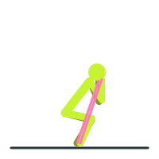<br><sub>Band Squat to Press</sub></td><td align="center"><br><sub>Shadow Boxing</sub></td><td align="center"><br><sub>Deep Breathing</sub></td></tr>
<tr><td align="center">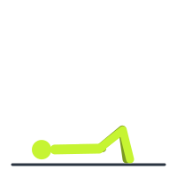<br><sub>Glute Bridges</sub></td><td align="center"><br><sub>Burpees</sub></td><td align="center">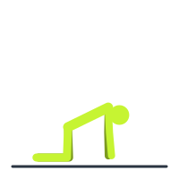<br><sub>Cat-Cow</sub></td><td align="center">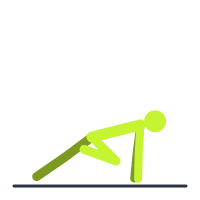<br><sub>Mountain Climbers</sub></td></tr>
<tr><td align="center"><br><sub>Crunches</sub></td><td align="center"><br><sub>Bicep Curls</sub></td><td align="center"><br><sub>Romanian Deadlift</sub></td><td align="center">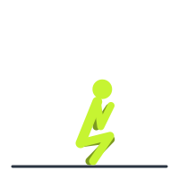<br><sub>Deep Squat Hold</sub></td></tr>
<tr><td align="center"><br><sub>Forward Fold</sub></td><td align="center">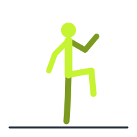<br><sub>High Knees</sub></td><td align="center">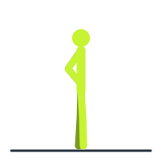<br><sub>Hip Openers</sub></td><td align="center"><br><sub>Jumping Jacks</sub></td></tr>
<tr><td align="center">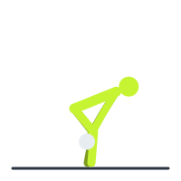<br><sub>Kettlebell Swings</sub></td><td align="center"><br><sub>Reverse Lunges</sub></td><td align="center">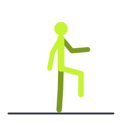<br><sub>March in Place</sub></td><td align="center">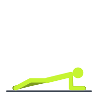<br><sub>Plank Hold</sub></td></tr>
<tr><td align="center"><br><sub>Dumbbell Shoulder Press</sub></td><td align="center"><br><sub>Band Pull-Aparts</sub></td><td align="center">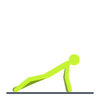<br><sub>Push-ups</sub></td><td align="center">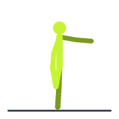<br><sub>Standing Quad Stretch</sub></td></tr>
<tr><td align="center">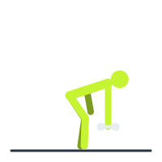<br><sub>Dumbbell Rows</sub></td><td align="center">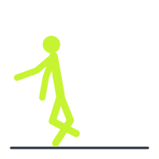<br><sub>Skater Hops</sub></td><td align="center"><br><sub>Bodyweight Squats</sub></td><td align="center">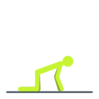<br><sub>Thoracic Rotations</sub></td></tr>
<tr><td align="center">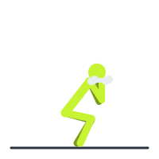<br><sub>Dumbbell Thrusters</sub></td><td align="center">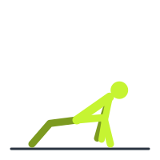<br><sub>World's Greatest Stretch</sub></td></tr>
</table>

## Why

Fitness apps on TVs need to *show* each move, but videos are heavy, need licensing, and can't adapt to whatever exercise an AI coach invents. These demos are a few kilobytes of keyframes, render crisply at any resolution, recolour to your theme, and pause with your workout.

## What's inside

- **`src/index.ts`**: no dependencies, no React imports.
  - `ANIMATIONS`: 30 exercises (warm-up, strength, cardio, mobility, dumbbell / kettlebell / band moves). Each is a list of poses (hip position, torso angle, arm and leg angles or foot/hand targets) with timings.
  - A **two-bone IK solver** keeps feet and hands planted (squats, push-ups, planks), and keyframes ease between poses.
  - `skeletonAtTime(anim, ms)` and `shapesFor(anim, skeleton)` give you the lines and dots to draw for any moment. The shape count is constant, so frames tween.
  - `animationFor(name, phase)` maps free-text names such as "Goblet Squat", "Bent-Over Row" or "Butt Kicks" to the closest demo (handy for LLM-generated workouts). `hasDedicatedAnimation(name)` tells you when it's a fallback.
- **`svg/`**: one self-animating SVG per exercise (SMIL, loops forever), plus `index.html`, a gallery page.
- **`scripts/build-svgs.ts`** regenerates the SVGs; **`scripts/check.ts`** checks every animation stays finite, on the canvas, and above the floor.

## Use it

React Native (react-native-svg) or the web:

```ts
import { animationFor, skeletonAtTime, shapesFor } from 'tv-exercise-figures';

const anim = animationFor('Bodyweight Squats', 'main');
const shapes = shapesFor(anim, skeletonAtTime(anim, elapsedMs));
// shapes: { kind: 'poly', pts: [[x, y], ...], w, role } | { kind: 'dot', c: [x, y], r, role }
// draw them in a 200×200 viewBox; role = 'near' | 'far' | 'prop' | 'band'
```

Or just drop an SVG in: ``.

```bash
npm install
npm run check       # all 30 animations OK
npm run build:svgs  # regenerate svg/
```

Coordinates: 200×200 box, y down, ground at y = 180, side-view figures face right.

## License

MIT, see [LICENSE](LICENSE). Contributions (new moves, better poses) welcome.
